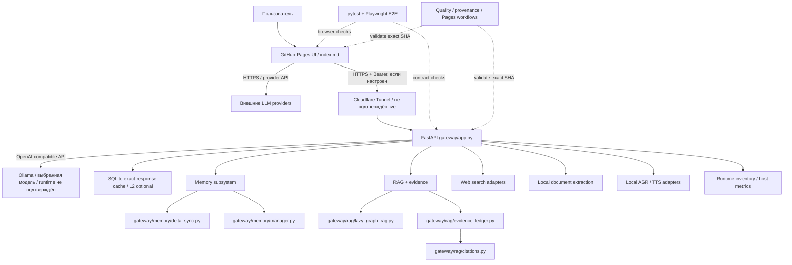

# aLandi — карта архитектуры и модулей

**Срез:** `main` = `3887b408988e0476251736a8e7a3e3374eb2ce58`.  
**Тип:** кураторская схема границ модулей по дереву репозитория и фактическим route/function declarations. Это **не** автоматически извлечённый call graph и не доказательство live deployment.

## 1. Системная схема

**Граница достоверности:** Tunnel/Ollama — целевая схема, не доказательство наличия сервера. Успешный Pages workflow не подтверждает VPS, credentials, Tunnel или model runtime.

## 2. Контуры и границы

| Контур | Точки входа | Что важно |
|---|---|---|
| Клиент | `index.md` | Большой статический HTML/JS; история и настройки в браузере. Browser API keys не являются server-side vault. |
| Gateway | `gateway/app.py`, `gateway/README_RU.md` | FastAPI: health/capabilities/models/chat, admin, memory, RAG, search, documents, audio. VPS не подтверждён live. |
| Routing | `gateway/routing.py` | Детерминированная allowlist-политика; общий helper-model cascade не считать включённым. |
| Memory graph | `gateway/memory/manager.py`, `scope.py`, `conflict.py`, `temporal.py` | SQLite, scope, provenance, статусы фактов; API opt-in. Это граф памяти продукта, не граф исходного кода. |
| Delta sync | `gateway/memory/delta_sync.py` | Versioned patch/revision conflict; не автоматическая синхронизация всех browser records. |
| Retrieval/RAG | `gateway/rag/lazy_graph_rag.py` | SQLite FTS5 + lexical concepts; baseline, не dense vector RAG и не полный LazyGraphRAG. |
| Evidence | `gateway/rag/evidence_ledger.py`, `citations.py` | Source URI, offsets/hash и scope должны сохранять проверяемую связь с источником. |
| Tool DAG | `gateway/tools/dag_engine.py`, `validator.py`, `gateway/security/approval_gates.py` | Bounded prototype; не production shell sandbox. |
| SSRF | `gateway/security/ssrf_protection.py` | Helper destination validation; важно корректно вызывать после DNS resolution и перепроверять redirect chain. |
| Documents | `gateway/app.py`, `gateway/tests/test_document_extraction.py` | Ограниченное извлечение; не обещать универсальную поддержку форматов. |
| Voice | `gateway/voice/`, `gateway/tests/test_audio_*.py`, `tests/e2e/audio-transcription.spec.mjs` | ASR/TTS adapters и UI есть в коде, но нужны бинарники/модели/flags; качество и latency на целевом устройстве не измерены. |
| Research UI | `index.md`, `tests/e2e/research-*.spec.mjs` | Search & Research Studio; внешний поиск зависит от CORS, лимитов и настроенного адаптера. |
| Quality | `.github/workflows/`, `scripts/check_project_metadata.py`, `scripts/check_license_manifest.py` | Проверки относятся к точному SHA; зелёный CI не подтверждает runtime на VPS. |

## 3. Маршруты gateway, проверенные в `gateway/app.py`

- `GET /livez` (process liveness), `GET /readyz` (Ollama readiness), legacy `GET /healthz` (alias readiness)
- `GET /v1/capabilities`, `GET /v1/models`
- `GET /admin/cache/stats`, `GET /admin/runtime`
- `GET/DELETE /v1/memory/state/{conversation_id}`, `POST /v1/memory/delta`
- `GET/POST /v1/memory/graph/nodes`, `POST /v1/memory/graph/search`, `POST /v1/memory/graph/relations`, review/delete routes
- `POST /v1/rag/ingest`, `POST /v1/rag/retrieve`, `DELETE /v1/rag/documents/{document_id}`
- `GET /v1/search/web`, `POST /v1/documents/extract`
- `POST /v1/audio/transcriptions`, `POST /v1/audio/speech`, `POST /v1/chat/completions`

Перед изменением API перечитать сам route, settings/flag и тесты; этот список — навигация, не контракт.

## 4. Где проверять

- UI: `tests/e2e/app.spec.mjs`, `alandi-provider.spec.mjs`, `document-attachments.spec.mjs`, `audio-transcription.spec.mjs`, `research-studio.spec.mjs`, `research-evidence.spec.mjs`, `context-budget.spec.mjs`.
- Gateway: `gateway/tests/test_app.py`, `test_six_layers.py`, `test_v016_foundation.py`, `test_document_extraction.py`, `test_audio_*.py`, `test_searxng_search.py`.
- Release: Quality Sentinels, Pages deployment/browser smoke, provenance gate. Проверять exact PR HEAD, затем post-merge main.
- Для memory: project scope, candidate/confirmed, deletion propagation и recovery semantics.

## 5. Graphify — следующий эксперимент, не runtime-интеграция

Источники: [Graphify-Labs/graphify](https://github.com/Graphify-Labs/graphify), [quickstart](https://docs.graphify.com/quickstart), [pyproject.toml](https://github.com/Graphify-Labs/graphify/blob/v8/pyproject.toml).

Подтверждено upstream:
- Apache-2.0; PyPI package `graphifyy`, CLI `graphify`, Python `>=3.10`;
- code graph использует локальный tree-sitter AST; semantic pass для docs/media может обращаться к настроенной модели;
- outputs: `graph.html`, `GRAPH_REPORT.md`, `graph.json`; доступны query/explain/path;
- немалый dependency footprint (NetworkX, NumPy, RapidFuzz, PyYAML и tree-sitter grammars) — не добавлять в gateway/runtime.

Пилот при наличии сетевого изолированного workspace:
1. Установить в disposable окружение и зафиксировать версию.
2. Запустить code-only/local workflow без semantic pass для docs/media и без hosted Cloud.
3. Исключить secrets, env-файлы, пользовательские данные и build output; проверить ignore semantics.
4. Записать files/nodes/edges, coverage, время/память и результаты 10 реальных вопросов по навигации.
5. Сравнить с прямыми исходниками и orienter; generated graph сохранять вне production, пока польза и воспроизводимость не доказаны.

**Первый реальный прогон (PR #68, run #40532798178):** Graphify `0.9.96` успешно построил 1,717 nodes / 2,877 edges / 140 communities; extraction + clustering заняли примерно 5 секунд. Артефакт #12745794677 сохранён на 7 дней и проверен локально. Но первый граф не принят как качественная навигация: 539 узлов пришли из `docs/PROJECT_STATE.yaml`, 460 из workflow YAML; SQL schema была пропущена из-за отсутствующего `tree_sitter_sql`; `index.md` — основной UI — не попал в graph; широкая query вернула 49 nodes/45 edges и over-budget notice; `--no-label` оставил названия `Community N`.

**Улучшение пилота:** workflow дополнен SQL extra, исключением YAML/YML/TOML metadata из graph corpus и извлечением inline JavaScript из `index.md` в временный `index-inline.js` с сохранением исходного количества строк, чтобы line numbers соответствовали `index.md`. Refined run #40534094060 успешен: 940 nodes, 2,637 edges, 44 communities, 59 source files; UI JS и SQL schema представлены. Последующий run #40534892152 успешно выполнил 10 узких вопросов: каждый вернул 10–151 узел (UI Research Studio 55, bounded parsing 50, RAG 52, audio 31, evidence provenance 10). Budget 700 — приблизительный; один ответ вышел на ~762 токена. Artifact #12747755798 (SHA-256 `e16c01df143a3380bfd66be523ec709d2dc85bf35fd4d8e5133a64922a841b22`) хранится 7 дней. Cache не попадает в artifact. Граф полезен для dev-навигации, но communities не имеют семантических имён без model calls; Graphify остаётся dev-only, не runtime dependency.

**Лицензионная оговорка:** release tag `v0.9.96` и PyPI package `graphifyy==0.9.96` указывают Apache-2.0, но default-branch `pyproject.toml` на момент исследования показывал старые metadata `0.1.14`/MIT. Пилот фиксирует конкретную опубликованную версию; не распространять вывод о лицензии на все upstream refs без отдельной сверки.

## 6. Правило поддержки

Карта помогает навигации, но не заменяет исходники. Обновлять её, если изменились границы модулей. После каждого этапа обновлять orienter, `docs/PROJECT_STATE.yaml` и `docs/VOLLEY_LOG.md` с точным SHA, проверками, blockers и следующим действием.

### 5.1. Автоматизированный пилот в CI

- Workflow `.github/workflows/graphify-pilot.yml` запускается при изменении самого workflow на `main`, при PR с изменением workflow/ignore/architecture map и вручную через `workflow_dispatch`.
- Разрешения: только `contents: read`; checkout не сохраняет credentials; semantic/model processing отключён.
- Результат хранится как краткоживущий artifact, не коммитится. После выполнения нужно проверить отчёт и минимум 10 навигационных вопросов; один лишь зелёный exit code не доказывает полезность графа.
